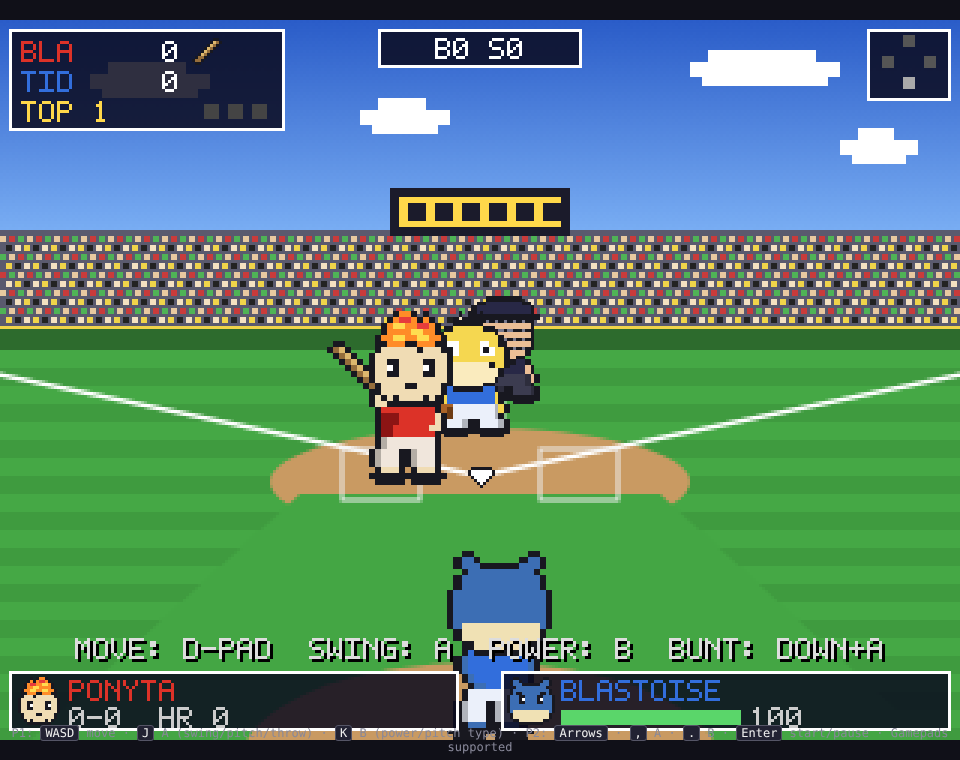
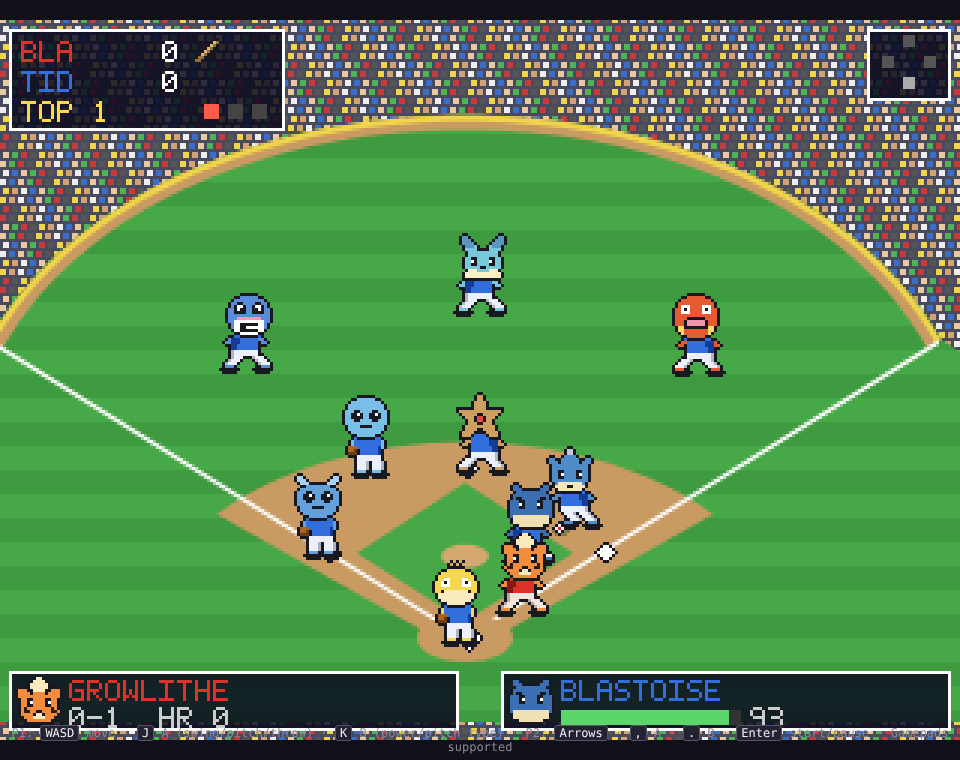

# Poké Ball Park

A Pokémon baseball game that plays like **Ken Griffey Jr. Presents Major League
Baseball** on the SNES: a behind-the-pitcher batting view with a pitch-steering
pitcher and a timing-based swing, an overhead fielding view where you run the
nearest fielder and fire throws to bases, and simple one-button base running.

Everything is drawn from pixel-art sprite sheets (`assets/sprites/*.png`) on a
320×240 canvas scaled up with crisp pixels. No build step, no dependencies.

 

## Play

Serve the folder over HTTP (ES modules won't load from `file://`):

```sh
npm start            # serves on http://localhost:8080
# or: python3 -m http.server 8080
```

Open the URL in a browser. Works in Chrome, Firefox, Safari, Edge.

### Controls

| Action                      | Player 1       | Player 2        | Gamepad          |
|-----------------------------|----------------|-----------------|------------------|
| Move / aim / pick base      | `W A S D`      | Arrow keys      | D-pad / stick    |
| **A** – swing, pitch, throw | `J` (or Space) | `,`             | A / X            |
| **B** – power swing, pitch type, retreat runners | `K` | `.`   | B / Y            |
| Start / pause               | `Enter`        | `Enter`         | Start            |
| Mute                        | `M`            |                 |                  |

**Pitching (behind-the-plate view).** Move the cursor to aim, press B to cycle
pitches (fastball, curve, slider, changeup, plus your team's type special such
as *Flame Ball* or *Bubble Ball*), press A to throw. While the ball is in the
air, hold left/right to steer it — the signature Griffey trick. Pitches cost
stamina; a tired pitcher loses velocity and control.

**Batting.** Move left/right to shift your Pokémon in the box so the bat covers
the pitch. A is a contact swing, B is a slower, stronger power swing, Down+A
bunts. Swing timing decides where the ball goes: early pulls it, late goes to
the opposite field; low pitches become grounders, high ones fly balls.

**Fielding (overhead view).** You automatically control the fielder closest to
the ball. Run under flies to catch them, pick up grounders, then hold a
direction and press A to throw: Up = 2nd, Left = 3rd, Right = 1st, Down = home.
Step on a base or tag a runner by running into them.

**Base running.** Runners go automatically on contact. Press A to send everyone
an extra base, B to retreat.

### Modes

* **1P vs CPU** – you bat first as the away team.
* **2P Versus** – both players on one keyboard or two gamepads.
* **Watch CPU vs CPU** – attract mode.
* Choose 3, 6 or 9 innings on the title screen. Extra innings break ties.

### Teams

Four nine-Pokémon squads, each with a type special pitch:

* **Pallet Pikas** (Electric/Normal) – Pikachu, Eevee, Raichu, Snorlax, Electabuzz, Meowth, Clefairy, Jigglypuff, Magnemite
* **Cinnabar Blaze** (Fire) – Ponyta, Growlithe, Charizard, Magmar, Flareon, Charmeleon, Charmander, Vulpix, Cyndaquil
* **Cerulean Tides** (Water) – Vaporeon, Squirtle, Lapras, Blastoise, Wartortle, Staryu, Poliwag, Psyduck, Magikarp
* **Viridian Vines** (Grass) – Chikorita, Oddish, Ivysaur, Venusaur, Exeggutor, Weepinbell, Bulbasaur, Tangela, Bellsprout

Each species has power, contact, speed, arm, glove and pitching ratings in
`src/data/pokemon.js`; rosters and colours live in `src/data/teams.js`.

## Project layout

```
index.html              page + canvas
src/main.js             boot, fixed-step loop, scene switching
src/assets.js           loads sheets, recolours the shared body per team/species
src/gfx.js              pixel drawing + bitmap font
src/input.js            keyboard & gamepad, two players
src/audio.js            synthesised sound effects
src/data/               species stats, pitches, teams
src/game/rules.js       innings, outs, counts, runners, scoring
src/game/physics.js     batted / thrown ball flight
src/game/field.js       field geometry (feet)
src/game/play.js        pitch → swing → fielding → base-running state machine + CPU AI
src/render/batview.js   behind-the-pitcher view
src/render/fieldview.js overhead field view
src/render/hud.js       scoreboard, messages
src/scenes/             title, team select, game, results
tools/build_sprites.py  ASCII pixel art → PNG sprite sheets (+ sprites.json)
tools/sprite_*.py       the art itself
tests/                  headless simulation + Playwright smoke test
```

## Sprites

All art is original pixel art defined as ASCII in `tools/sprite_heads.py`,
`tools/sprite_body.py` and `tools/sprite_misc.py`. One shared body is
recoloured at runtime (species colour for limbs, team colours for the jersey)
and a 16×16 species head is composited on top for every animation frame —
the same trick the SNES game used to fit a whole league into cartridge space.

Regenerate the sheets after editing the art:

```sh
npm run sprites       # python3 tools/build_sprites.py  (needs Pillow)
```

## Tests

```sh
npm test              # simulates several CPU vs CPU games through the state machine
node tests/diag.mjs   # prints batting-average / K% / HR% balance numbers
npm run smoke         # Playwright: loads the game in Chromium, plays, screenshots
```
