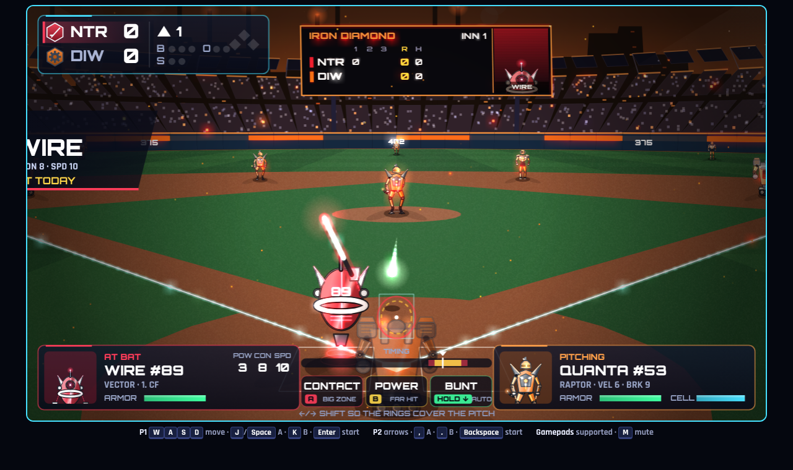
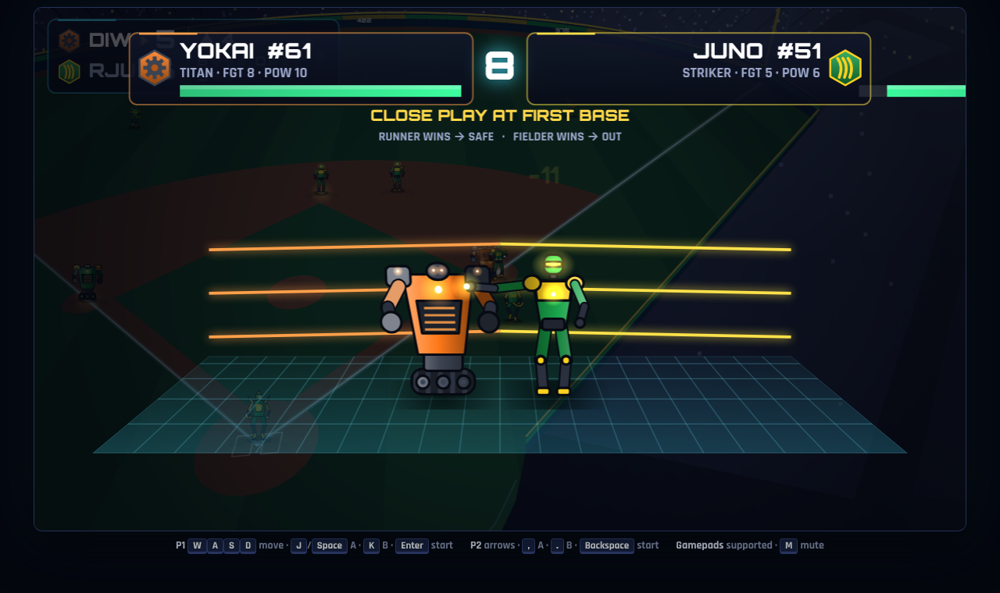

# Iron Diamond

Robot baseball with a fight on every close play: an original game in the spirit of
the old NES robot-baseball games, rebuilt with modern vector graphics, a 3D night
ballpark, 12 clubs and four modern robot frames.

No build step, no dependencies. Serve the repo over HTTP and open `iron-diamond/`:

```sh
npm start      # then http://localhost:8080/iron-diamond/
```




## On a phone

Hold the phone sideways for the full-screen view; the d-pad, A, B and Start
appear as translucent touch buttons and the HUD moves to the top of the screen.
Hits, clash blows and explosions vibrate on phones that support it, and Android
gets a FULL button for true fullscreen. **Settings → Effects** chooses AUTO
(the default, which drops the glow and light effects if the phone can't keep
60 fps), HIGH or LOW.

On a phone you can also tap menu items, team cards and garage rows directly
(tap once to pick, again to confirm).

To publish a single-file copy (for hosting anywhere):

```sh
python3 tools/build_iron_diamond.py iron-diamond-single.html
```

## Modes

- **Exhibition**: 1 player vs CPU, 2 players head to head, or CPU vs CPU to watch.
- **Season**: play an 11-round round robin against every other club while
  the rest of the league plays its own games. Standings track W-L, games back and
  run differential; the top 4 make the playoffs (semifinal, then the Iron
  Diamond Series final). You can play each game or sim it. Damage, credits and
  the garage work as in the Gauntlet.
- **Gauntlet**: pick a club and beat 5 opponents plus a final, with 3 continues.
  Armor damage carries over between matches. Earn credits for wins, runs,
  strikeouts and destroyed bots, then spend them in the **Garage** on repairs,
  rebuilding scrapped bots and club-wide upgrades (power, contact, speed, fight,
  arm, plating). Progress saves in the browser. Forfeiting a match from the
  pause menu counts as a loss and keeps the damage.
- **Settings**: 3/5/7/9 innings, Rookie/Pro/Legend difficulty, clashes on/off, sound, music.

## Controls

| Action | Player 1 | Player 2 | Gamepad / touch |
|---|---|---|---|
| Move / aim / shift | `W A S D` | arrows | d-pad / stick |
| **A**: swing, pitch, throw, strike | `J` / `Space` | `,` | A |
| **B**: power swing, pitch type, retreat, heavy | `K` | `.` | B |
| Start / pause | `Enter` | `Backspace` | Start |
| Mute | `M` | | |

**Batting.** After every swing you get feedback (PERFECT, EARLY, LATE,
MISSED · TOO HIGH…). On Rookie a dashed ring shows where the pitch will cross.
Shift left/right so the glowing ring covers the pitch. A is a contact
swing, B a power swing (smaller window, harder hit), Down+A bunts. Swing early to
pull, late to go the other way; high pitches fly, low pitches bounce.

**Pitching.** Aim with the d-pad, B cycles Fastball / Curve / Slider / Changeup /
Plasma, A throws. Hold left/right to steer the ball in flight. Every pitch drains the
pitcher's power cell (Plasma drains 14). From the pause menu you can bring in your
reliever.

**Fielding.** You run the fielder nearest the ball. With **Field Assist** on
(Settings; AUTO turns it on for Rookie and touch screens) the fielder chases the
ball whenever you let go of the d-pad and makes the throw if you hesitate. A yellow ring marks where a fly
ball will land. With the ball, hold a direction and press A to throw (→ 1st, ↑ 2nd,
← 3rd, ↓ home; no direction picks the smart play), or run onto the base or into
the runner yourself.

**Running.** Runners go on grounders and wait on fly balls. A sends everyone
another base, B sends them back.

**Clash.** A close play at a base becomes a 9-second brawl in a holo-ring: ←/→
move, A strike, B heavy (breaks guard), Down guards. If the runner wins, they're
safe; if the fielder wins, the runner is out. When time runs out, whoever dealt more
damage wins. Damage is permanent, and a bot that hits 0 armor is **destroyed** and
replaced from the bench (or by a scrap drone).

## Broadcast touches

- **Instant replay**: home runs, walk-offs and long running catches replay at
  half speed from low broadcast angles, letterboxed. A skips.
- **Walk-up intros**: every new batter gets a lower-third card with today's
  line (H-for-AB, HR, RBI, K).
- **Play-by-play** ticker, swing feedback, crowd cheers, and a jumbotron in
  centre field showing the batter.

## Home parks

Each club's stadium has its own sky, skyline, weather and light: rain over the
neon district in Neo Tokyo, smokestacks and embers in Detroit, Earth rising over
the Moon, red dust and two moons on Mars, bubbles and caustics under Atlantis,
aurora and snow in the Arctic, pyramids under a gold moon in Cairo, a sunset
harbour in Sydney, and more. Stadium dirt, grass and colour grading change with
the park.

## The league

Twelve clubs, each with its own colours, emblem, frame mix and strengths: Neo Tokyo
Ronin, Detroit Ironworks, Nova Vegas Voltage, Lunar Base Eclipse, Mars Colony Dust
Devils, Atlantis Abyss, Silicon Valley Kernels, Arctic Circuit Glaciers, Cairo Sphinx
Protocol, Berlin Blitz, Rio Jaguar Units, Sydney Solar Flares.

Four robot frames:

- **Striker**: balanced combat android
- **Titan**: treaded heavy siege frame; huge power and armor, slow
- **Vector**: hover drone; fastest runner and best glove, fragile
- **Raptor**: digitigrade hunter-killer; quick and vicious in a clash

## Code

`src/core.js` (input, synth audio, 3D camera), `data.js` (clubs, frames, rosters),
`robots.js` (vector robot renderer), `stadium.js` (ballpark), `match.js` (rules,
physics, AI), `clash.js`, `render.js` (match view + HUD), `ui.js` (menus, Gauntlet),
`main.js` (loop). Test hooks: `?demo=1&speed=8` plays CPU vs CPU fast-forwarded.

```sh
npm run test:id   # plays 3 full CPU games headlessly and checks the menu flow
```
