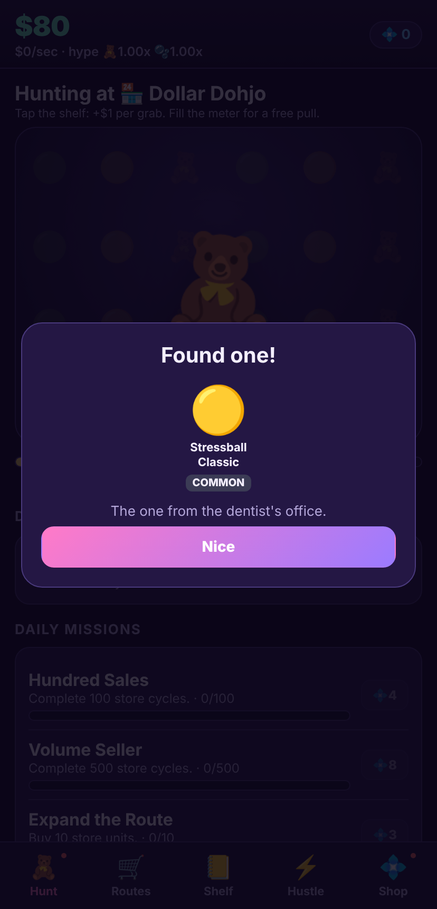
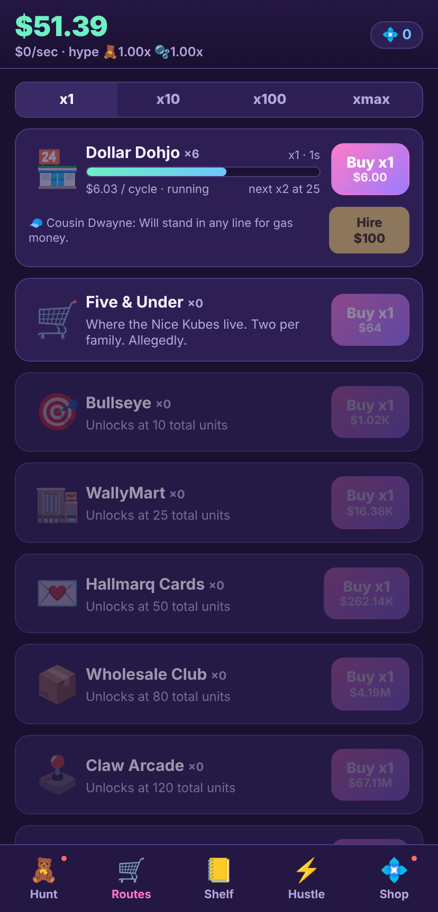
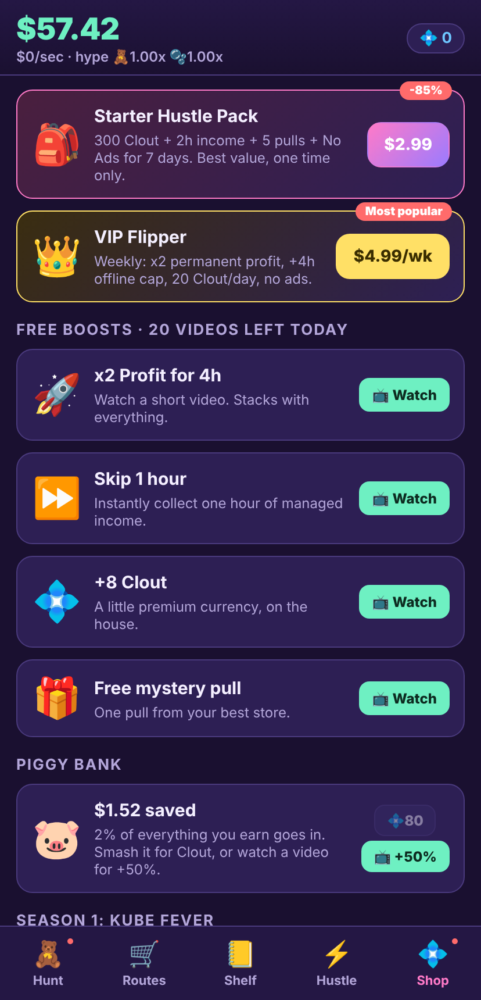

# Scalp Street: Idle Flip Tycoon

An idle tycoon about scalping squish plush and doh fidget toys. Camp the
drops, hoard the squishes, flip the dohs, get found out, relocate, repeat.
Web first (PWA), built to wrap into an iOS app with Capacitor.

  

## Run it

```sh
npm install
npm run dev        # http://localhost:5173
npm run build      # production bundle in dist/ (PWA, works offline)
npm run preview    # serve dist/
npm test           # engine unit tests (vitest)
npm run smoke      # headless browser run-through with screenshots
npm run balance 8  # greedy-bot economy sim for 8 simulated hours
```

## What is in the game

- **10 stores** (Dollar Dohjo through the Factory Back Door) with unit
  milestones, managers that automate, and 3 upgrades each.
- **36 collectible items** in two families and six rarity tiers, a mystery
  pull gacha with published odds, a shelf bonus, duplicate flipping.
- **Live market**: squish and doh hype meters plus five timed events
  (Drop Day, Viral Video, Holiday Squad, Restock Flood, Limit Crackdown).
- **Relocate** prestige for Street Cred (+2% profit per point forever) and
  a Reputation shop.
- **Offline earnings** with an upgradeable cap and a watch-to-double offer.
- **Retention**: daily login streak, daily missions, 30-tier Hustle Pass,
  25 achievements, piggy bank, red-dot badges.
- **Monetization** (simulated on web, real SDKs on iOS): six rewarded
  video placements with cooldowns and a daily cap, one interstitial slot
  (after prestige), starter pack, remove ads, weekly VIP subscription,
  premium pass, five Clout packs, a bundle, Clout sinks.
- Versioned local save with export/import codes, autosave, PWA service
  worker, safe-area aware mobile layout, haptics.

## Docs

- [`docs/market-research.md`](docs/market-research.md): the 2026 squish and
  doh resale market, scalper culture, comparable games, monetization
  benchmarks, sources.
- [`docs/game-design.md`](docs/game-design.md): core loop, systems, economy
  table, screens, roadmap.
- [`docs/monetization.md`](docs/monetization.md): every placement, product,
  price point, cooldown, and the compliance checklist.
- [`docs/ios-plan.md`](docs/ios-plan.md): Capacitor shell, plugin mapping
  for AdMob/StoreKit/haptics/notifications/cloud save, store readiness.

## Layout

```
src/engine/        pure TS game engine (types, data tables, math, sim, prestige, zustand store)
src/monetization/  provider interface + simulated web provider
src/ui/            React screens: Hunt, Routes, Shelf, Hustle, Shop, overlays
tests/             vitest engine tests + Playwright smoke test
tools/balance.ts   economy simulation used to tune the store table
docs/              research, design, monetization, iOS plan, screenshots
```

All brands and characters are parodies. Nothing in the web build charges
money or shows real ads.
