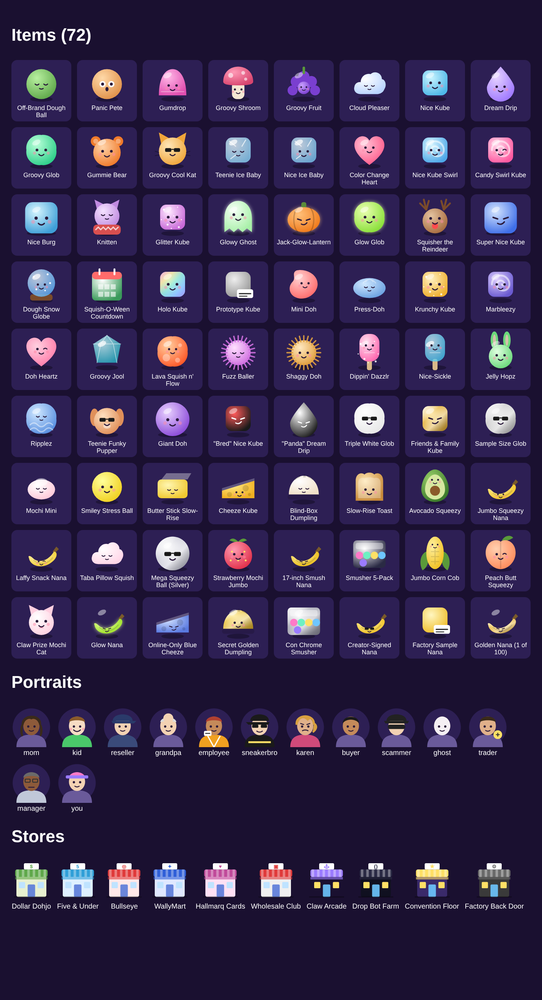
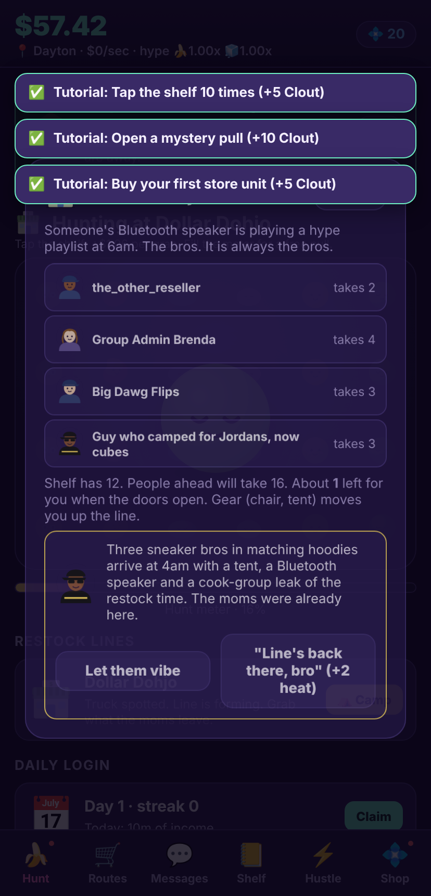
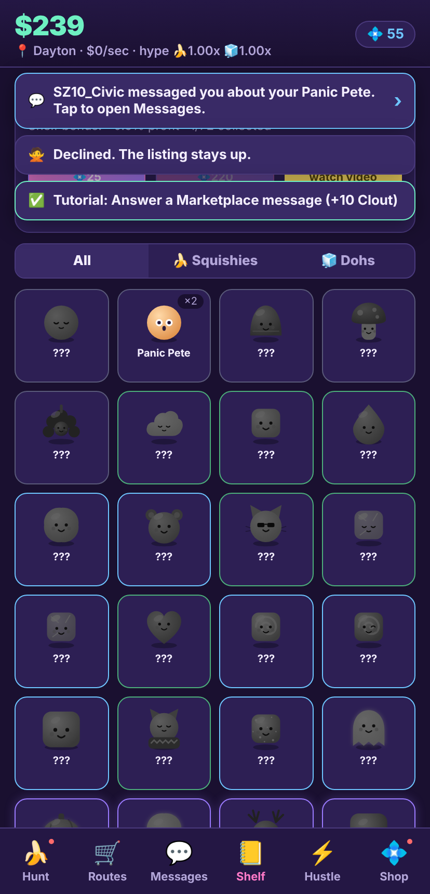
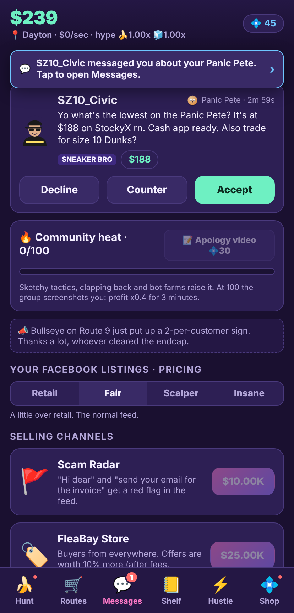

# Scalping Squishies: Idle Flip Tycoon

An idle tycoon about scalping squeezy fidget toys: NeeDoh-style dough
cubes and globs, and the viral jumbo squishy bananas, cheese cubes, butter
sticks and blind-box dumplings. Camp the drops, hoard the bananas, flip the
dohs, get found out, relocate, repeat.
Web first (PWA), built to wrap into an iOS app with Capacitor.



  

## Run it

```sh
npm install
npm run dev        # http://localhost:5173
npm run build      # production bundle in dist/ (PWA, works offline)
npm run preview    # serve dist/
npm test           # engine unit tests (vitest)
npm run smoke      # headless browser run-through with screenshots
npm run soak       # 2-minute randomized browser play session, fails on any error
npm run balance 8  # greedy-bot economy sim (stores, deals, restocks) for 8 simulated hours
```

## What is in the game

- **10 stores** (Dollar Dohjo through the Factory Back Door) with unit
  milestones, managers that automate, and 3 upgrades each.
- **72 collectible items** in two families (Dohs and Squishies) and six
  rarity tiers, a mystery pull gacha with published odds, a shelf bonus,
  duplicate flipping.
- **Original art**: every item, rival, buyer and storefront is an original
  vector sprite composed at runtime from a shape library (`src/art/`):
  jelly gradients, highlights, glitter, glow, holo, chrome and gold
  finishes, seven kawaii face types, and character portraits for NeeDoh
  Moms, kids, sneaker bros, Karens, scammers and the manager. Zero image
  files, crisp at any size, and the whole set is reviewable at `/#art`.
- **Feel**: synthesized sound effects (Web Audio, no asset files) for
  taps, cash, buys, pulls by rarity, grabs, doors, deals and getting Called
  Out, plus confetti on rare pulls and overtakes, screen shake and flashes.
- **Tutorial**: a nine-step first-time checklist that completes itself from
  play and pays Clout.
- **Cities**: Relocate offers a choice of two cities, each with a perk
  (Fresno: stores 15% faster, Tampa: offers worth 25% more, Vegas: pull
  luck, Scranton: heat cools 2x, Boise: skip 3 in line, Phoenix: carry +4,
  Seattle: bot farm 2x, ...). Your city shows in the header.
- **Local scalper rankings**: eleven fake rivals from Little Timmy to The
  Manufacturer. Overtake each one for Clout and confetti.
- **Con Weekend**: every Saturday and Sunday, restock trucks are 50% fuller.
- **Restock runs**: stand in line at 6am behind NeeDoh Moms ("two per
  FAMILY", she brought the family), little kids with birthday money, other
  resellers and the employee holding one for a friend. When the doors open
  you mash GRAB for 12 seconds while a kid reaches for the last one, a mom
  parks her cart across the aisle and films you for the group, Dalton
  offers to split the shelf, and the manager says "Sir. SIR. Two per
  customer." Spare the kid or step over him. Lie about cousins and risk a
  10-minute store ban. Gear (folding chair, tent, minivan, four "cousins")
  moves you up the line and raises your carry.
- **Sneaker bros**: they pivoted from Dunks to dough. They camp the line
  with a tent and a Bluetooth speaker (take 3 to 4 each), "legit check"
  cubes by smelling them, race you for the row when the StockyX chart hits
  4x, and show up in the Deals feed paying hype prices in a Civic, then
  back out when "the chart dipped 4%". Sneaker-style colorways on the shelf:
  "Bred" Nice Kube, "Panda" Dream Drip, Triple White Glob, Friends & Family
  Kube, Sample Size Glob.
- **Facebook pricing dial**: Retail, Fair, Scalper or Insane. Higher
  pricing makes offers worth up to 2.8x but floods the feed with lowballs,
  ghosts and Karens, and Insane slowly raises Heat.
- **Deals feed**: a Facebook-Marketplace-style stream of buyers for the
  items on your shelf. Fair buyers, lowballers, "is this available?"
  ghosts, Zelle and Friends & Family scammers, trade offers and angry
  community members. Accept, counter or decline. Selling channels (FleaBay,
  Mercarry, WhatNow live shows, Scam Radar, Goods & Services only, UV tag
  light) change how the feed behaves.
- **Heat and sketchy tactics**: Return the Empty Box, Employee Hookup,
  Shelf-Clearing Sweep, "Sealed" (It Is Not Sealed), Captcha Farm, Fake
  Haul Video. Big multipliers, each adds community Heat. At 100 Heat the
  group screenshots you and profit drops to x0.4 for three minutes. Cool
  off over time or buy an apology video with Clout.
- **Counterfeits**: some pulls from sketchier stores are fakes. Toss them,
  or flip them anyway for cash and Heat.
- **Community drama ticker** with ISO posts, restock sightings, scam PSAs
  and group-rule reminders.
- **Live market**: squishy and doh hype meters plus five timed events
  (Drop Day, Viral Video, Squishmas Drop, Restock Flood, Limit Crackdown).
- **Relocate** prestige for Street Cred (+2% profit per point forever) and
  a Reputation shop.
- **Offline earnings** with an upgradeable cap and a watch-to-double offer.
- **Retention**: daily login streak, daily missions, 30-tier Hustle Pass,
  piggy bank, red-dot badges.
- **Monetization** (simulated on web, real SDKs on iOS): six rewarded
  video placements with cooldowns and a daily cap, one interstitial slot
  (after prestige), starter pack, remove ads, weekly VIP subscription,
  premium pass, five Clout packs, a bundle, Clout sinks.
- 35 achievements, 11 daily mission types.
- Versioned local save with export/import codes, autosave, PWA service
  worker, safe-area aware mobile layout, haptics.

## Docs

- [`docs/market-research.md`](docs/market-research.md): the 2026 squish and
  doh resale market, scalper culture, comparable games, monetization
  benchmarks, sources.
- [`docs/game-design.md`](docs/game-design.md): core loop, systems, economy
  table, screens, roadmap.
- [`docs/monetization.md`](docs/monetization.md): every placement, product,
  price point, cooldown, and the compliance checklist.
- [`docs/ios-plan.md`](docs/ios-plan.md): Capacitor shell, plugin mapping
  for AdMob/StoreKit/haptics/notifications/cloud save, store readiness.

## Layout

```
src/engine/        pure TS game engine (types, data tables, math, sim, prestige, zustand store)
src/monetization/  provider interface + simulated web provider
src/art/           vector sprite system: shapes, per-item art table, Sprite, Portrait, StoreSprite, contact sheet
src/ui/            React screens: Hunt, Routes, Deals, Shelf, Hustle, Shop, overlays
tests/             vitest engine tests + Playwright smoke test
tools/balance.ts   economy simulation used to tune the store table
docs/              research, design, monetization, iOS plan, screenshots
```

All brands and characters are parodies. Nothing in the web build charges
money or shows real ads.
